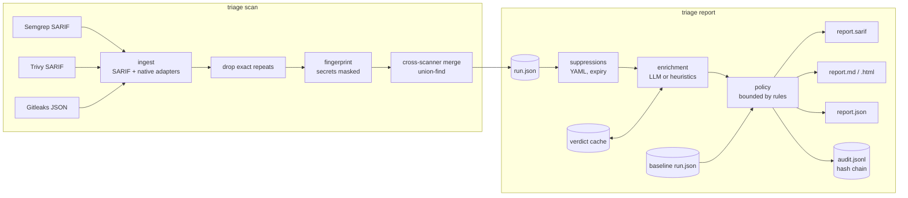

# findings-triage

A triage layer for code-security scanners. It takes the raw output of **Semgrep** (SAST),
**Trivy** (dependencies, IaC, secrets) and **Gitleaks** (secrets) and turns it into a short list
a developer can act on, with every decision recorded and explainable.

- **Stable fingerprints** that survive line shifts, reformatting and refactors
- **Cross-scanner dedup**: the same JWT reported by three tools is one finding
- **Suppressions as code**: YAML with reason, author and expiry, validated strictly
- **Optional LLM enrichment** (Claude) with bounds an LLM verdict cannot cross
- **Hash-chained audit log** and `triage replay`, which reproduces any report byte for byte
- **SARIF for GitHub code scanning**, Markdown for PR summaries, a self-contained HTML report,
  and CI exit codes

```
Juice Shop:  307 raw results → 281 after dedup → 152 actionable (heuristics) → 121 with 1 suppression rule
Flask:        37 raw results →  37 after dedup →   3 actionable
Gin:          50 raw results →  49 after dedup →  26 actionable → 9 with 1 suppression rule

3 months of real Juice Shop history (464 files changed):
  line-number IDs report 26 new + 27 fixed findings; fingerprints report 0 new + 1 fixed,
  and git confirms that one line really changed.
```

All numbers are measured; the method and the misses are in [Evaluation](#evaluation). A real
report for Gin (Markdown, HTML, SARIF) is in [`examples/sample-report/`](examples/sample-report/).

## Why

Scanners are cheap to run and expensive to read. On a real repository they produce duplicates
(three tools flag the same key), out-of-scope noise (tests, example apps, docs), and
low-confidence rules firing on framework code. Line-number-based IDs make it worse: insert a
license header and every finding below it is "new". Teams respond by ignoring the output, which
is the failure mode that matters.

The judgment step, deciding what to show, what to hide, at what severity, and being able to say
*why* months later, is the part that needs engineering. This tool is that step, kept small
enough to audit.

## Quickstart

Requires Python 3.12+ and the scanners on `PATH` (`semgrep`, `trivy`, `gitleaks`).

```bash
git clone https://github.com/OWNER/findings-triage && cd findings-triage
uv sync                                   # or: pip install -e .
triage scan path/to/repo -o .triage/run.json           # runs all three scanners
triage report .triage/run.json --enrich heuristic      # writes .triage/report/report.{sarif,md,html,json}
open .triage/report/report.html
```

Already have scanner output? `triage scan path/to/repo -i semgrep.sarif -i trivy.sarif -i gitleaks.json`.

To turn on LLM enrichment, install the extra and set a key; `--enrich auto` (the default) uses it
when credentials are present and falls back to heuristics otherwise:

```bash
pip install -e ".[llm]"
export ANTHROPIC_API_KEY=...
triage report .triage/run.json
```

## How it works



`triage scan` produces the **facts**: what the scanners found, deduplicated, fingerprinted,
with secret-masked code context. `triage report` produces the **decisions**. The split means
decisions can be re-made (a suppression edited, a policy changed) without re-scanning, and a
report is a pure function of files that can be hashed. That is what makes replay possible.

### Fingerprints

| Kind | Hashed | Not hashed |
|---|---|---|
| code, config | scanner, rule, path, flagged lines with all whitespace removed, occurrence index | line numbers, surrounding lines |
| secret | scanner, rule, path, flagged line **with the secret masked out** | the secret value, line numbers |
| dependency | scanner, advisory, ecosystem, package, installed version, manifest path | lockfile line numbers |

Removing whitespace makes the ID survive reindentation and a formatter re-wrapping an
expression. Identifiers and comments are deliberately *not* normalized, so a real code change
produces a new ID. The occurrence index separates identical snippets in one file (the same
unsafe call twice) and only shifts when an identical match is inserted above.

### Dedup

Fingerprint identity ("same finding as last run?") and duplication ("same issue as that other
report?") are separate. Every scanner report keeps its own fingerprint; merged reports become
**aliases** of the primary, and diffs and suppressions match on either. Adding a scanner
therefore never makes existing findings look new.

Merge rules: secrets on overlapping lines (any scanner); dependencies with the same advisory,
package, version and manifest; code and config from *different* scanners on overlapping lines
that share a CWE or are listed in [`equivalences.yaml`](src/triage/data/equivalences.yaml).
Every entry in that table was added after seeing both rules fire on the same lines and reading
both descriptions. Co-location alone is not enough (see [misses](#where-triage-was-wrong-or-uncertain)).

### Suppressions

```yaml
version: 1
suppressions:
  - id: SUP-001
    match:
      rule: "semgrep:yaml.github-actions.security.github-actions-mutable-action-tag.*"
      path: ".github/workflows/**"
    reason: CI-only exposure, accepted until workflows move to SHA pins.
    author: security@example.com
    created: 2026-10-01
    expires: 2027-01-31
```

`reason` and `author` are required, unknown keys are rejected, and an invalid file fails the run
(exit 2), because a typo like `expire:` would otherwise become a permanent suppression. After
`expires` the rule stops matching and the report names the lapsed rule. Rules that match nothing
are reported as stale. Suppressed findings stay in the SARIF with a `suppressions` entry, so
GitHub shows them as dismissed with the justification. See
[`examples/triage.suppressions.yaml`](examples/triage.suppressions.yaml).

### Enrichment: the LLM advises, policy decides

For each unsuppressed finding (highest severity first, up to `--max-llm-findings`), the tool sends
the finding and ±8 lines of secret-masked code to Claude and gets back schema-constrained JSON:
`exploitable`, `reachable`, `suggested_severity`, `confidence`, `reasoning`. Without
credentials, or when a call fails, deterministic heuristics answer instead (test/docs/example
paths, placeholder secrets, manifests that are not shipped, the rule author's own
`LOW CONFIDENCE` label).

The repository is untrusted input to the LLM, so the policy assumes a prompt injection will
sometimes succeed and bounds what any verdict can do:

- **Nothing is hidden by the LLM.** Only a human-written suppression hides a finding; the
  strongest verdict moves it to *review*, where it is still listed.
- Severity moves at most two levels down and one up from what the scanner reported.
- Low-confidence verdicts are shown but don't change severity.
- A secret outside test code never drops below medium.
- Repository content is delimited and escaped, and the output is schema-validated twice
  (API structured output, then pydantic).

Verdicts are cached by `fingerprint + prompt version + model + prompt hash`. Re-runs only pay for
new or changed findings, and `--enrich cache-only` never calls the API, which is how replays and CI
re-runs stay reproducible even though model output is not deterministic. Refusals, rate limits
and schema failures fall back to heuristics per finding; auth errors disable the LLM for the
rest of the run. The report is always produced.

| Variable | Default | |
|---|---|---|
| `TRIAGE_LLM_PROVIDER` | `anthropic` | `none` disables LLM enrichment |
| `TRIAGE_LLM_MODEL` | `claude-opus-5-5` | |
| `TRIAGE_LLM_EFFORT` | `medium` | `low` … `max` |
| `TRIAGE_LLM_CONCURRENCY` | `4` | parallel requests |

### Audit log and replay

`--audit-log .triage/audit.jsonl` appends one event per report (input hashes, as-of date, output
hashes) and one per finding (bucket, severity change, the suppression or verdict behind it). Each
event includes the previous event's hash.

Real output from the Juice Shop evaluation run:

```console
$ triage explain e9f1418f --audit-log audit.jsonl
run 26d72d843be84ce5 (recorded 2026-10-23T10:46:10+00:00, event #239)
  semgrep:javascript.sequelize.security.audit.sequelize-injection-express.express-sequelize-injection at data/static/codefixes/dbSchemaChallenge_1.ts:5
  bucket: suppressed, severity high -> high
  - suppressed by JS-001 (eval): Answer options for the coding challenges. routes/vulnCodeFixes.ts and vulnCodeSnippet.ts read these files as text to show them to players; they are never executed or deployed as infrastructure.

$ triage verify-log audit.jsonl
ok: 282 events, head 6aec0171bb39d73a939e7e5050985fadba000bb6e413cac84bc32ff925ce2658

$ triage replay --audit-log audit.jsonl
ok: run 26d72d843be84ce5 reproduced byte-for-byte (html, json, md, sarif)
```

The chain is tamper-*evident*: editing, deleting or reordering an event breaks verification. It
is not tamper-*proof*: whoever can rewrite the file can rebuild the chain. That is why
`verify-log` prints the head hash, to anchor somewhere the writer can't change (CI artifact,
signed tag, PR comment).

## CI

| Exit | Meaning |
|---|---|
| 0 | nothing actionable at or above `--fail-on` (default `high`) |
| 1 | actionable findings at or above `--fail-on` |
| 2 | bad input: invalid suppression file, broken audit log, replay mismatch |
| 3 | a scanner failed or its output could not be read |

A broken pipeline never looks green. In pull requests, `--baseline base.json --new-only` fails
only on findings the PR introduced, which is what makes the tool adoptable on a codebase with
existing debt. [`examples/github-action.yml`](examples/github-action.yml) scans the PR's base and
head, uploads SARIF to code scanning, writes the Markdown summary to the job page, caches LLM
verdicts and keeps the audit log as an artifact. Its actions are pinned to commit SHAs.

## Evaluation

Run on 2026-10-23 on macOS with Semgrep 1.99.0 (`p/default`), Trivy 0.76.1 and Gitleaks 8.30.1.

| Repository | Commit | Why |
|---|---|---|
| [OWASP Juice Shop](https://github.com/juice-shop/juice-shop) | `717f5efa8` | intentionally vulnerable (TypeScript, Terraform, Docker) |
| [pallets/flask](https://github.com/pallets/flask) | `d086db856` | popular, well-maintained Python library |
| [gin-gonic/gin](https://github.com/gin-gonic/gin) | `0f09c3a9b` | popular Go web framework |

Juice Shop does not commit a lockfile, so Trivy finds no dependencies. Before scanning I ran
`npm install --package-lock-only --ignore-scripts` in the root and `frontend/`, which resolves
versions without running install scripts or writing `node_modules`. The resolution is as of the
run date; resolving again later yields newer versions and different dependency counts.

Everything below is reproduced by [`eval/run_eval.sh`](eval/run_eval.sh)
(`SKIP_SCAN=1` re-derives all numbers from saved scanner reports in about a minute).

### Funnel

| | Juice Shop | Flask | Gin |
|---|---|---|---|
| Raw results (Semgrep / Trivy / Gitleaks) | 307 (69 / 169 / 69) | 37 (16 / 15 / 6) | 50 (40 / 6 / 4) |
| After dedup | 281 | 37 | 49 |
| merged across scanners | 21 | 0 | 1 |
| merged within one scanner | 5 | 0 | 0 |
| Actionable, no enrichment (severity ≥ medium) | 229 | 36 | 48 |
| **Actionable, heuristics** | **152** | **3** | **26** |
| Actionable, heuristics + one suppression rule | 121 | – | 9 |

The suppression rules are in [`eval/suppressions/`](eval/suppressions/): Juice Shop's
`data/static/codefixes/**` (160 coding-challenge answer files that `routes/vulnCodeFixes.ts`
reads as text and never runs) and Gin's mutable GitHub Action tags (accepted with an expiry).

Of the 21 Juice Shop cross-scanner merges, the largest groups are the same JWT flagged by
Gitleaks, Semgrep and Trivy (3 reports → 1), and the same private key in `lib/insecurity.ts`
and both Terraform copies flagged by Gitleaks and Trivy.

**Reading the Juice Shop result:** the remaining 121 is mostly correct. The application is
vulnerable on purpose. The 26 code and secret findings left actionable include the documented
challenges: SQL injection in `routes/login.ts` and `routes/search.ts`, the open redirect, `/ftp`
directory listing, `sendFile` path handling in the file servers, the hardcoded RSA key and HMAC
secrets in `lib/insecurity.ts`. 63 of the 121 are npm advisories with a published fix.

**Reading the Flask result:** of 37 results, 3 stay actionable: a Werkzeug advisory in `uv.lock`
(real, fix available), a uv dependency-cooldown setting (supply-chain hygiene), and SHA-1 in
`sessions.py` (a miss, see below). 14 of the 15 dependency findings are in
`examples/celery/requirements.txt`, the 6 secrets are all in `docs/*.rst`, and the `eval`/`exec`
in `cli.py` and `config.py` are Flask's documented PYTHONSTARTUP and `from_pyfile` behavior. All
of those land in review, still listed.

### Fingerprint stability

**Real history.** Juice Shop `64bda9aa8` (2026-07-25) → `717f5efa8` (2026-10-23): 464 files
changed, +8082/−3040 lines, including an "Auto-fix linting issues" commit and several refactors.
Both commits scanned the same way. Every finding a diff calls new or fixed is checked against
`git diff` to see whether its lines actually changed
([`eval/stability.py`](eval/stability.py)).

| Diff key | unchanged | new | fixed | new/fixed not explained by `git diff` |
|---|---|---|---|---|
| line number (scanner, rule, path, line) | 202 | 26 | 27 | (all 53 are line shifts) |
| **fingerprint** | 229 | **0** | **1** | **0** |

The one fixed finding is real: commit `c61af6120` replaced `utils.contains(subs, …)` with
`subs.includes(…)` in `routes/videoHandler.ts`, and the Semgrep rule no longer matches.

**Synthetic refactor.** [`eval/synthetic_refactor.py`](eval/synthetic_refactor.py) inserts a
7-line header into every source file (every line shifts) and doubles the indentation of every
JS/TS/Python line, then all three scanners run again.

| | files changed | fingerprint new / fixed | line-number key new / fixed |
|---|---|---|---|
| Juice Shop | 762 | **0 / 0** (281 unchanged) | 197 / 197 of 303 |
| Flask | 92 | **0 / 0** (37 unchanged) | 4 / 4 of 37 |
| Gin | 110 | **0 / 0** (49 unchanged) | 42 / 42 of 50 |

(Flask's line keys barely move because most of its findings sit in templates, docs and manifests
the script does not edit.)

### Time

On a 2020 MacBook Air (quad-core i5-1030NG7, 8 GB), warm Trivy DB:

| | Juice Shop | Flask | Gin |
|---|---|---|---|
| Scanners (Semgrep + Trivy + Gitleaks) | 39.1 + 5.9 + 17.2 s | 23.4 + 2.0 + 0.9 s | 17.4 + 1.6 + 1.0 s |
| `triage scan` ingest, fingerprint, dedup | 3.4 s | 1.2 s | 1.0 s |
| `triage report` (heuristics, all formats) | 1.6 s | 0.9 s | 1.0 s |

Triage time includes ~0.6 s of Python start-up.

### LLM cost

**Not measured against the live API.** I built and tested the LLM path without an API key: the
request shape, structured-output parsing, caching, refusal and error handling are covered by
tests against a fake client, but verdict quality and real token usage are not measured yet.

What is measured is the exact prompt the tool would send, built from these runs
([`eval/prompt_budget.py`](eval/prompt_budget.py)):

| | Juice Shop | Flask | Gin |
|---|---|---|---|
| Findings sent (unsuppressed, cap 200) | 200 | 37 | 49 |
| Prompt size, mean / max characters | 2,644 / 5,005 | 2,271 / 2,659 | 2,297 / 2,818 |
| Input tokens, *estimated* at 3–4 chars/token | 132k–176k | 21k–28k | 28k–38k |
| Input cost at Claude Opus 5.5 list price, *estimated* | $0.53–0.71 | $0.08–0.11 | $0.11–0.15 |

Output tokens (including adaptive thinking) are not estimated. With the cache, a re-run costs
only the new or changed findings. To measure it yourself:
`ANTHROPIC_API_KEY=... triage report run.json --enrich llm`. The cost and token totals are
printed and included in the report.

### Dogfooding

Scanning this repository with itself: 3 raw results. Two are a Semgrep Python 3.7 compatibility
rule (reported at *high*, because the tool maps SARIF `error` to high without knowing the rule
is not about security), suppressed in [`triage.suppressions.yaml`](triage.suppressions.yaml)
since the project requires Python 3.12. The third, direct use of Jinja2, is in review: the
environment has autoescape on. 0 actionable.

### Where triage was wrong or uncertain

- **Flask `sessions.py:281`, SHA-1 kept actionable.** It is the documented HMAC digest for
  signed cookies, not a collision-sensitive use. Heuristics can't tell; a reviewer or the LLM
  pass would. This is the exact case the suppression in `examples/` documents.
- **Juice Shop `data/static/codefixes/`, treated as production code.** 56 findings in
  challenge answer files (Terraform and TypeScript), 31 of them actionable, looked shipped to
  the path heuristic. Fixed with a
  suppression rule that has a reason, which is the honest fix, not a heuristic tuned to the eval.
- **Two different secrets on one line get merged.** `oauth.component.spec.ts:91` has two
  Gitleaks `generic-api-key` hits on the same line; the secret merge rule assumes one credential
  per line and merged them.
- **Co-location is not duplication.** Trivy AWS-0052 ("drop invalid headers") and Semgrep
  `aws-elb-access-logs-not-enabled` fire on the same Terraform block and are different problems.
  An overlap-only merge would have hidden one; they stay separate, and the equivalence table only
  lists pairs verified by hand.
- **Secret masking is aggressive.** Long dotted identifiers (`challengeUtils.solveIf`) get masked
  along with secrets, so secret snippets are hard to read. That is the safe direction: across 70
  Juice Shop secret findings, no token-like value is left in the run file, report or prompt.
- **Gin's 18 response-writer findings were demoted on rule metadata, not analysis.** Semgrep
  labels `no-direct-write-to-responsewriter` LOW CONFIDENCE, and in a web framework's render
  package it is indeed the framework doing its job. A web *application* writing user input the
  same way would be demoted too, and it would then wait in review for a person or the LLM.
- **Dependency reachability is not analysed.** "Fix available" is the only signal; whether the
  vulnerable function is called is not checked.

### Case study: Gin and `golang.org/x/net`

**What the tool flagged.** In Gin `0f09c3a9b`, Trivy reported five advisories against
`golang.org/x/net v0.57.0` in `go.mod`. The heuristics kept all five actionable (one high, four
medium): a fix exists (v0.60.0), and reachability is unknown, because the tool does not analyse
dependency call graphs.

**What manual analysis showed.** Gin imports `x/net/http2` in exactly one place: `Engine.Handler()`
(`gin.go:257-264`) serves through `h2c.NewHandler(engine, &http2.Server{})` when the opt-in
`UseH2C` flag is set, and every `Run*` method goes through `Handler()`. govulncheck (symbol level)
and reading the code agree:

| Advisory | Issue | Reachable |
|---|---|---|
| GO-2026-6611 / CVE-2026-78669 | CPU exhaustion via repeated SETTINGS frames | only with `UseH2C` |
| GO-2026-6603 / CVE-2026-78659 | memory exhaustion via `Trailer` | only with `UseH2C` |
| GO-2026-6612 / CVE-2026-78663 | double flow-control refund | only with `UseH2C` |
| GO-2026-6617 / CVE-2026-97032 | crash from HPACK encoder race | only with `UseH2C` |
| GO-2026-6610 / CVE-2026-78660 | HTTP/2 `Transport` accepts malformed framing headers | no: client side, Gin never uses `http2.Transport` |

In the default configuration, HTTP/2 is served by the standard library's own copy of the same
code, which receives these fixes from the Go toolchain (1.26.9 / 1.27.2), not from `go.mod`.

**Outcome.** The tool confirmed a real issue, not a new discovery: a PR bumping x/net to v0.60.0
([gin-gonic/gin#4881](https://github.com/gin-gonic/gin/pull/4881)) was already open. I verified
that PR rather than opening a duplicate. The bumped modules require the same Go version as Gin
(1.26.0), the full test suite passes in all five CI variants on Go 1.26.9 and 1.27.3, and
govulncheck goes from four called vulnerabilities to zero.

**What it says about the tool.** The output was right that something needed fixing, but coarse
in two ways. One of the five advisories cannot be reached from Gin and still landed in
*actionable*. And the four that can be reached depend on an opt-in flag, which a CVE score cannot
express. Both are the dependency-reachability gap listed under [Limitations](#limitations). For Go
modules, govulncheck's symbol-level result is the obvious reachability signal to feed into the
policy (see [Roadmap](#roadmap)).

## Design decisions and trade-offs

- **Two commands, two artifacts.** Facts (`run.json`) and decisions (report) are separate so
  decisions can be re-made cheaply and reproducibly.
- **Whitespace-insensitive, not AST-based, fingerprints.** AST hashing needs a parser per language
  and doesn't apply to lockfiles, config or secrets. Removing whitespace gets most of the
  robustness with none of that.
- **Path is part of the identity.** Moving a file changes its findings' IDs. Git rename detection
  is on the roadmap.
- **One LLM request per finding.** It keeps the cache granular and limits how far an injection in
  one file can reach. Batching would be cheaper per token.
- **Fail loud on configuration, fail visible on findings.** Invalid suppressions stop the run; an
  expired suppression brings the finding back rather than keeping it hidden.
- **Masking over hashing for secrets.** A hash of a low-entropy secret can be brute-forced; masking
  stores nothing derived from the value. Rotating a secret in place keeps its fingerprint, because
  the exposure point is the finding.
- **Three buckets, no score.** Actionable / review / suppressed is a list a developer works through.
  A numeric score invites endless threshold tuning.

## Limitations

- Path heuristics are regular expressions over paths. They miss repo-specific layouts (see the
  Juice Shop codefixes case).
- The LLM layer is unmeasured against the live API (see above).
- No dependency reachability analysis.
- File moves change fingerprints; two secrets on one line merge.
- The audit log has no signature; anchoring the head hash is left to the CI system.
- Severity comes from the scanner. Non-security rules that a ruleset includes (Semgrep's
  compatibility checks) arrive with security-looking severities.
- Ingest knows the three target scanners' SARIF dialects. Other SARIF producers work through the
  generic path, with coarser kind and severity mapping.

## Roadmap

1. A labelled eval set (two reviewers, ~200 findings) with precision and recall of the actionable
   bucket per enrichment mode, gating prompt and policy changes.
2. Live LLM measurement: verdict agreement with the labels, tokens, cost, latency.
3. Git rename detection so moved files keep their findings' identity.
4. Signed audit-log anchors (Sigstore).
5. Batch API for nightly full scans. Reachability from existing call-graph tools: govulncheck's
   symbol-level results for Go modules first (motivated by the Gin case study), osv-scanner for
   other ecosystems.

## Development

```bash
uv sync --all-extras
uv run pytest          # 72 tests: fingerprints, dedup, suppressions, policy, audit log, LLM, replay
uv run mypy            # strict
uv run ruff check src tests eval
```

## License

MIT
